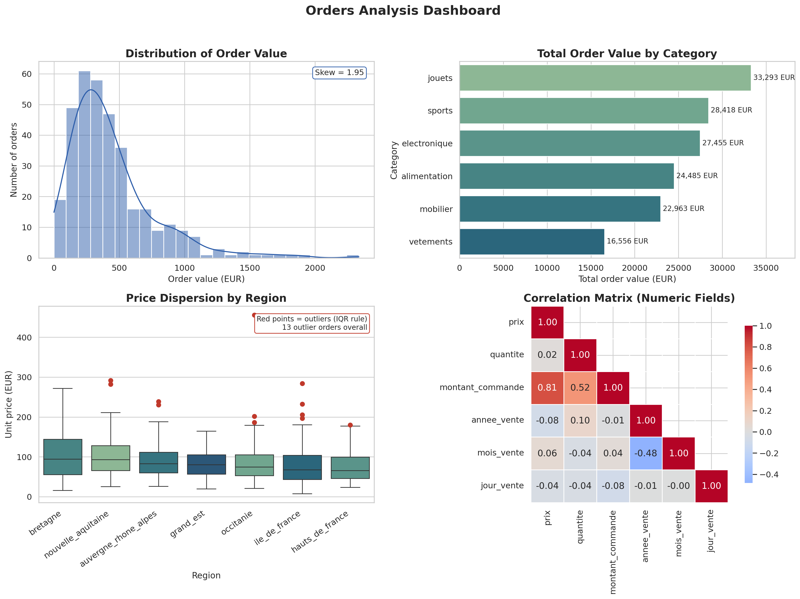

# Orders Analysis

A descriptive-analytics dashboard that turns a messy, multi-language French retail
orders export into a clean dataset, five publication-quality charts, and a set of
business-readable insights — no black-box modeling, just careful cleaning and clear
visualization.

## Overview

The source file is a 368-row orders export riddled with the kind of mess you'd
actually find in production data: category and region names spelled four different
ways (`Électronique`, `electro`, `ÉLECTRONIQUE`), emails with `AT` instead of `@`,
negative prices, comma-decimal amounts, mixed date formats, and missing values
scattered across every column. None of that is fixable by eyeballing a spreadsheet.

The approach: profile the mess first, normalize text fields (accents, casing,
whitespace, abbreviations) into a consistent schema, recompute the order-value
field from its components instead of trusting the dirty source column, impute the
remaining gaps sensibly, and then let the cleaned data drive five charts and a
short list of concrete findings.

The result is a 351-row cleaned dataset, a 2x2 summary dashboard, five standalone
charts, and a handful of insights that would actually be useful to someone running
category or regional strategy — not just a distribution plot for its own sake.

## Dataset

- **Source**: `data/raw/messy_orders_data.csv` (not committed — see
  [Tech stack](#tech-stack) / `.gitignore`; it contains synthetic customer emails,
  so it's excluded from version control on principle even though it's small)
- **Size**: 368 raw rows → 351 after deduplication (17 exact duplicates), 10 raw
  columns → 13 after cleaning (dropped the dirty `montant` column, added
  `montant_commande`, `annee_vente`, `mois_vente`, `jour_vente`)
- **Key columns**: `produit`, `categorie` (6 values), `region` (7 French regions),
  `prix`, `quantite`, `montant_commande` (derived), `date_vente`, `statut`
  (`livre` / `annule` / `en_cours` / `retourne`)
- **Time span**: January 2025 through early February 2026 (the final month is
  partial — 6 orders only — so don't read the February drop on the trend chart as
  a real decline)
- **Known limitations**: missing values ranged from ~1% (`produit`, `categorie`,
  `region`) up to 27% (`montant`, before it was dropped) and 13% (`statut`) in the
  raw file; missing categoricals/numerics were filled with the column mode, which
  is a reasonable default for a portfolio piece but would need a better strategy
  (e.g. group-wise imputation) for production use

## Key Insights

- **Toys lead, but the category spread is tight.** `jouets` is the top category
  at €33,293 in total order value, only ~17% ahead of the lowest category
  (`vetements`, €16,556) — see `outputs/figures/02_comparison_by_categorie.png`.
  This isn't a category with one runaway winner; it's six categories pulling
  roughly comparable weight.
- **Order values are right-skewed** (skew = 1.95): most orders land between
  €100–500, but a long tail of larger orders stretches out to ~€2,300 — see
  `outputs/figures/01_distribution_montant_commande.png`. A "typical order" summary
  stat (mean alone) would overstate what most customers actually spend.
- **Unit prices vary meaningfully by region.** Bretagne averages €106.60 per unit
  vs. €77.43 in Hauts-de-France — a ~27% spread — see
  `outputs/figures/03_dispersion_by_region.png`. Regional pricing or product mix
  isn't uniform across the country.
- **Price outliers are concentrated, not random.** 13 orders (3.7%) sit outside
  the IQR fence on price, and they cluster in Nouvelle-Aquitaine and
  Île-de-France rather than spreading evenly — worth a manual audit before
  trusting regional averages at face value.
- **Order value is driven almost entirely by price, not quantity.** `prix`
  correlates with `montant_commande` at r = 0.81, while `quantite` only reaches
  r = 0.52 — see `outputs/figures/04_correlation_heatmap.png`. Revenue growth
  levers here look more like pricing/mix than "sell more units per order."
- **Revenue has a late-cycle spike, not a steady trend.** May 2025 (€15,467) and
  January 2026 (€17,367) stand out well above the ~€10–12k baseline in every other
  full month — see `outputs/figures/05_trend_monthly_revenue.png`. Worth checking
  whether those months carried a promotion or seasonal effect.

## Dashboard preview



## Tech stack

- **Python 3.9+**
- **pandas / numpy** — cleaning, transformation, aggregation
- **matplotlib / seaborn** — all charting
- **reportlab** — PDF business résumé generation (`docs/project_resume.pdf`)

## Project structure

```text
project-root/
├── README.md
├── requirements.txt
├── .gitignore
├── data/
│   ├── raw/            # original dataset (gitignored, see Dataset section)
│   └── processed/      # orders_cleaned.csv, regenerated by src/main.py
├── src/
│   ├── __init__.py
│   ├── data_loading.py    # load + clean logic
│   ├── analysis.py        # descriptive stats / groupby / aggregations
│   ├── visualization.py   # all chart-generation functions
│   └── main.py             # thin entrypoint
├── outputs/
│   ├── figures/         # 5 standalone charts
│   └── dashboard.png    # combined 2x2 dashboard
└── docs/
    ├── project_resume.pdf
    └── skills_applied.md
```

## How to run

```bash
git clone https://github.com/sankara226/ORDERS-DATA-ANALYSIS.git
cd ORDERS-DATA-ANALYSIS
python3 -m venv .venv && source .venv/bin/activate
pip install -r requirements.txt

# place the raw CSV at data/raw/messy_orders_data.csv, then:
python3 -m src.main
```

This prints a short data-quality/insights summary to the console and (re)writes
`data/processed/orders_cleaned.csv`, `outputs/dashboard.png`, and all five charts
in `outputs/figures/`.

To regenerate the PDF business résumé (run after the step above, since it embeds
the chart PNGs `src/main.py` produces):

```bash
python3 scripts/build_resume_pdf.py
```

## What I'd do next

- **Audit the 13 price outliers by hand.** The IQR rule flags them, but it can't
  tell me whether they're genuine premium orders, bulk purchases, or data-entry
  errors — that needs a look at the actual rows.
- **Investigate the May 2025 / January 2026 revenue spikes** against an external
  calendar (promotions, holidays) instead of treating them as unexplained noise.
- **Replace mode-imputation with group-aware filling** (e.g. fill missing `prix`
  using the median for that `produit`, not the global mode) — a natural Week 7
  data-quality follow-up.

## Author / links

- GitHub: [sankara226/ORDERS-DATA-ANALYSIS](https://github.com/sankara226/ORDERS-DATA-ANALYSIS.git)
- Portfolio: _add link here_
